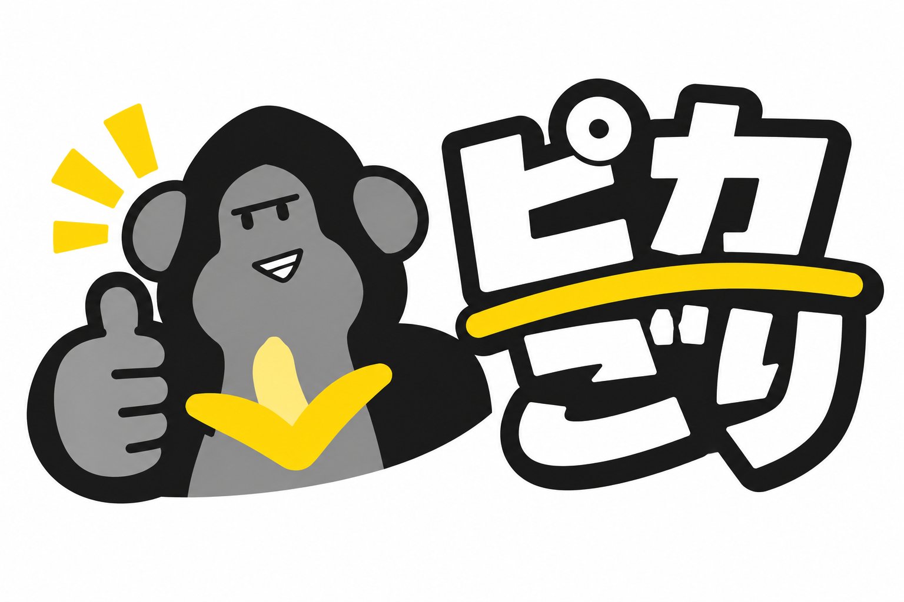
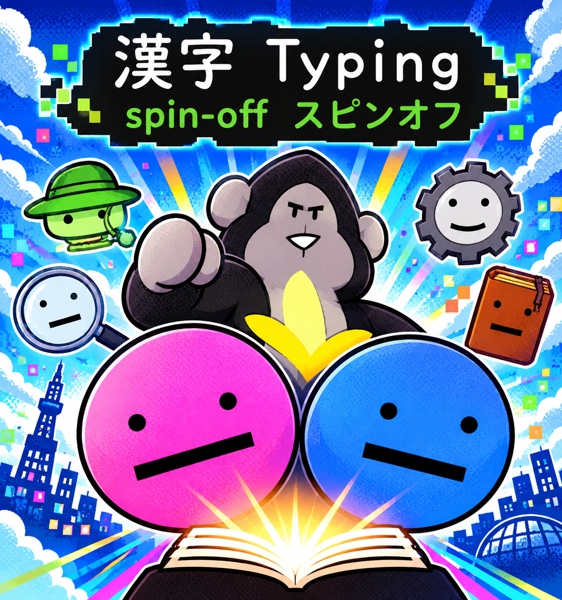

<!DOCTYPE html>
<html lang="ja">
<head>
<meta charset="UTF-8">
<meta name="viewport" content="width=device-width, initial-scale=1.0">
<meta name="theme-color" content="#ffd400">
<meta name="description" content="ピカごり公式サイト">

<title>ピカごり | 公式サイト</title>

</head>

<body>

<!-- HEADER -->

<header>
  

    <a href="#" class="logo">
      
      ピカごり
    </a>

    <nav>
      <a href="#news">NEWS</a>
      <a href="#about">ABOUT</a>
      <a href="#character">CHARACTER</a>
      <a href="#contents">CONTENTS</a>
      <a href="#contact">CONTACT</a>
    </nav>

  

</header>

<main>

<!-- HERO -->

<section class="hero">

  

    

      <small>PIKAGORI OFFICIAL WEBSITE</small>

      <h1>
        pikagori_yukke　公式ページ
      </h1>

      <a href="#character" class="button">
        ピカごりを知る →
      </a>
    

    

      
    

  

</section>

<!-- NEWS -->

<section class="section" id="news">

  

    <small>WHAT'S NEW</small>
    <h2>NEWS</h2>
    
ピカごりからのお知らせ

  

  

    <article class="news-card">

      

        <video
          id="op-video"
          autoplay
          muted
          loop
          playsinline
          preload="auto"
          aria-label="ピカごりのオープニング動画">

          <source src="open.mp4" type="video/mp4">

          お使いのブラウザは動画に対応していません。

        </video>

      

      

        <small>2026.11.14 / お知らせ</small>

        <h3>
          ピカごり公式サイトがオープンしました！
        </h3>

      

    </article>

  

</section>

<!-- ABOUT -->

<section class="about" id="about">

  

    <small>ABOUT PIKAGORI</small>

    <h2>ピカごりについて</h2>

    

      ピカごりは、ひらめきの明るさと
      ゴリラの頼もしさをあわせ持つキャラクターです。
      親指を立てて、みんなに元気と笑顔を届けます。
    

  

</section>

<!-- CHARACTER -->

<section class="section character" id="character">

  

    <small>MEET THE CHARACTER</small>

    <h2>CHARACTER</h2>

  

  

  <h2>ピカごり</h2>

  

    pikagori 誕生日は2/10 好きなものは文房具です。
  

</section>

<!-- CONTENTS -->

<section class="about" id="contents">

  

    <small>pikagori-ivent</small>

    <h2>Ivent</h2>

    
  

</section>

<section class="about" id="contents">

  

    <small>PIKAGORI WORLD</small>

    <h2>CONTENTS</h2>

    

      ピカごりの世界をもっと楽しもう！ 
      これからさまざまなコンテンツを展開予定です。
    

  

</section>

</main>

<!-- FOOTER -->

<footer>

  <h2>
    <a href="https://www.youtube.com/@%E3%82%86%E3%81%A3%E3%81%91_%E4%B8%BC"
       target="_blank"
       rel="noopener noreferrer">
      ピカごりのYouTubeコンテンツを配信中!! ↗
    </a>
  </h2>

  

    © 2026 PIKAGORI. All Rights Reserved.
  

</footer>

</body>
</html>
